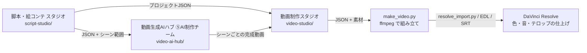

# Codex PR Test

GitHub CLIとCodexを使ったPull Requestワークフローを検証するためのリポジトリです。

## 目的

このリポジトリでは、次の一連の作業を安全に試せます。

- 作業ブランチの作成
- ファイルの変更とコミット
- GitHubへのブランチのpush
- Pull Requestの作成とレビュー

## 基本ワークフロー

1. `main`ブランチを最新の状態にします。
2. 作業内容に応じた新しいブランチを作成します。
3. 変更を加え、差分を確認してコミットします。
4. ブランチをGitHubへpushし、Pull Requestを作成します。
5. Pull Requestをレビューし、承認後にマージします。

> [!IMPORTANT]
> `main`ブランチは直接変更せず、必ずPull Requestを経由してください。

## 映画・動画づくりの全体の流れ
3分〜30分の動画を、企画から完成まで次の順で作ります。どの道具も、前の工程が書き出したJSONを読み込んで続きを進めます。



| 工程 | 道具 | やること |
|---|---|---|
| 1. 企画・脚本・絵コンテ | `script-studio/index.html` | ジャンル・尺・構成の型を選び、人物、シーン、カット(画面サイズ・カメラ・秒数)、セリフを決める。「学ぶ」タブで参考動画の型を研究する |
| 2. 素材づくり | `video-ai-hub/`(⑤AI制作チーム) | 絵コンテのシーン範囲(120秒・12カットまで)を、動画生成AIとClaudeの4エージェントで映像化する【有料】 |
| 2'. 素材集め | 撮影・ストック素材・図解 | 実写のカットは撮影リスト、AIのカットはプロンプトを動画制作スタジオから書き出して使う |
| 3. 組み立て | `video-studio/index.html` → `make_video.py` | カットに素材を割り当て、プレビューし、尺どおりにつないだ動画とResolve用ファイルを作る |
| 4. 仕上げ | DaVinci Resolve | `resolve_import.py` でタイムラインを作り、色・音・テロップを整えて書き出す |

Claude Code のサブエージェントも用意しています。`screenwriter`(脚本家)が脚本とJSONを書き、`video-director`(映像制作)が撮影リスト・AIプロンプト・ラフ編集・Resolve用ファイルを用意します(`.claude/agents/`)。

## 動画生成AI ハブ(`video-ai-hub/`)
動画生成AIのリンク集・プロンプト作成・API生成・履歴比較。
起動: `cd video-ai-hub && cp .env.example .env`(`GEMINI_API_KEY` を記入)→ `node server.js` → http://127.0.0.1:8000
- APIキーはサーバー(`.env`/環境変数)のみで保持。ブラウザへは返さず、動画もサーバー経由で中継。`.env`はgit管理外。
- 既定は `127.0.0.1` のみ待受。外部公開する場合は必ず `APP_TOKEN` を設定し、HTTPS(リバースプロキシ)を併用。
- 現在のAPI対応: Google Veo(`GEMINI_API_KEY`)/ Runway(`RUNWAY_API_KEY`)/ Luma(`LUMA_API_KEY`)/ fal.ai経由(`FAL_KEY`)でKling / MiniMax Hailuo / Alibaba Wan / ByteDance Seedance をモデル選択。`server.js` の `providers` に追加して拡張。
- **全API呼び出しは有料**。UIの「有料」チェックを入れないと生成ボタンは押せず(生成ごとに再確認)、サーバーも `confirmPaid` なしは拒否します。
- Runway は第三者情報ベース、fal.ai はモデルIDのみ公式ページで確認(縦横比はKlingのみ送信、他は未確認のため未送信)の実装で、有効なキーでの動作は未検証。モデル名は `RUNWAY_MODEL` / `LUMA_MODEL` で変更可。
- キー未設定/静的ホスティング時はAPIセクションが非表示になり、リンク集として動作。
- Sora(Web/アプリ)は2026年4月に提供終了のため掲載していません。料金・仕様は各公式で確認してください。

### ⑤ AI制作チーム(4人のエージェント)
Claude(`claude-opus-5-5`)の4人のエージェントが、意見を出し合いながら1本の動画を作ります。
- ①脚本家: 原作と依頼から脚本(場面・秒数・セリフ・ナレーション・人物の見た目の設定)
- ②撮影・生成担当: カメラワーク・人物の位置関係・光をショット表にし、動画生成AIで生成、コマ画像で確認して撮り直し
- ③監督: 秒ごとのタイムライン、声の配役(VOICEVOX)、セリフと映像・原作の整合のファクトチェック
- ④最終チェック: 完成版の照明・配置・流れ・カメラ・音を独立に判定し、担当者に数値付きで差し戻し
- 進め方: 「案 → ほかのメンバーの意見 → 書き手が修正(採否と理由を回答) → 再確認」を工程ごとに最大N回(FilmAgent・Camera Artist などの研究と、制作者の実践を参考)

**絵コンテから始める**: 「絵コンテから始める」に脚本・絵コンテ スタジオのJSONを読み込み、シーンの範囲を選ぶと、脚本とショット表の話し合いを省いて、絵コンテのカット割り・秒数・セリフどおりに生成します(1回 120秒・12カットまで。Claude の呼び出しも減ります)。完成した動画は、動画制作スタジオでそのシーンの素材として割り当てられます。

準備: `cd video-ai-hub && npm install`、`.env` に `ANTHROPIC_API_KEY` と動画生成AIのキー、ffmpeg(Mac: `brew install ffmpeg`)。声を付けるなら VOICEVOX を起動。テスト: `npm test`(APIを呼ばない代役で全工程を通す)。

注意:
- **有料**: Claude(1本あたり約20〜80回呼び出し)と動画生成の料金がかかります。生成回数と Claude の呼び出し回数に上限があります。
- 口の動きの確認は、コマ画像と声の長さからの判定です(音声の聞き取りはしません)。後付けの声は口の動きと合わないため、監督は画面外のナレーションを優先します。
- 素材は使ってよいものだけ: 自分の文章、青空文庫(取り扱い規準を確認)、VOICEVOX(「VOICEVOX:キャラ名」の表記。条件はキャラごとに確認)、利用条件を確認したBGM。完成時にクレジット一覧を表示します。

### デスクトップアプリ(Mac)
`desktop/` に、`video-ai-hub/` をMacアプリ(アイコンをダブルクリックで起動、Node.js不要)にする Electron 版があります。手順は `desktop/README.md`。

## 脚本・絵コンテ スタジオ(`script-studio/`)
3〜30分の映画・動画の脚本と絵コンテを作るブラウザアプリです。`script-studio/index.html` をブラウザで開くだけで使えます(サーバー・インストール不要)。
- **企画**:ジャンル(ドラマ/SF/ホラー/医療ドラマ/臨床医療・患者説明/医療者教育 など16種)、世界観、トーン、尺(3〜30分)、画面比率、構成の型(起承転結/三幕構成/序破急/患者説明型 など)を選ぶと、構成・シーン・カット割りの下書きを自動で作ります。
- **人物**:役割・目的・口調を設定。シーンごとに登場人物を選ぶと、台詞欄に名前を挿入できます。
- **構成**:ブロックごとの尺配分(%)と、目標尺に対する実際の尺を比較。
- **絵コンテ**:日本式の用紙(CUT/画面/内容/セリフ/秒)。画面サイズ・アングル・カメラワーク・構図から自動ラフを描き、手描きもできます。秒数は「秒+コマ」でも表示。
- **タイムライン**:全カットを尺の比率で表示。合計尺と目標尺の差、長すぎるカットを警告。シーンごとのIN/OUTを一覧。
- **プレビュー**:各カットを設定した秒数で順に再生(アニマティック)。
- **書き出し**:シナリオ形式の脚本(横書き/縦書き表示)、絵コンテCSV、AI動画プロンプト(動画生成AIハブ向け)、YouTubeチャプター、プロジェクトJSON。
- **学ぶ**:参考チャンネル(PIVOT、ABEMA Prime、ReHacQ、StudioBinder、DaVinci Resolve 公式トレーニング)の見どころ、すぐ使える編集手法、参考動画の平均カット長を出す分析メモ。ジャンル「ビジネス対談・ウェブ番組」「討論・ニュース番組」で、対談型・討論番組型の構成も作れます。
- 医療ジャンルでは、医学監修・出典・患者同意・医療広告ガイドライン・薬機法などの確認リストを表示します。
- データはブラウザ(localStorage)に自動保存されます。端末を変えるときはJSONで書き出してください。
- 参考にした市販・無料ソフトの機能:Final Draft(脚本書式、ビートボード)、Celtx(脚本・絵コンテ・香盤の一体管理)、StudioBinder(ショットリスト)、Boords(コマごとの尺とアニマティック)、Storyboarder(手描きコンテ)。
- 脚本家サブエージェント(`.claude/agents/screenwriter.md`)に、このアプリで読み込めるJSONを書かせることもできます。

## 動画制作スタジオ(`video-studio/`)
脚本・絵コンテから実際の動画を作る2つ目のプログラムです。
- `video-studio/index.html`(ブラウザで開く):プロジェクトJSONを読み込み、カットごとに作り方(実写撮影/AI動画生成/ストック素材/図解)を決めて、動画・画像を割り当てます。AI動画プロンプトの作成、字幕・常時テロップ付きのプレビュー、録画による動画の書き出し(WebM)、SRT・EDL・素材リストの書き出しができます。素材はブラウザ(IndexedDB)に保存されます。
- `video-studio/make_video.py`(ffmpeg が必要、Python 標準ライブラリのみ):
  ```
  python3 video-studio/make_video.py project.json --media media --out build [--height 720] [--burn-subs]
  ```
  カットごとに尺・解像度をそろえた動画を作ってつなぎます。素材がないカットは手描き絵コンテか文字のカードで埋まります。`build/` に完成動画、SRT、EDL、`resolve_import.py` を出力します。
- **DaVinci Resolve**:`resolve_import.py` を Resolve のスクリプトフォルダに置き、「ワークスペース > スクリプト」から実行すると、全カットを並べたタイムラインができます(無料版でもメニューからの実行は可)。色・音・テロップの仕上げは Resolve で行います。
- **AIエージェント**:`.claude/agents/screenwriter.md`(脚本家)と `.claude/agents/video-director.md`(映像制作・編集)。脚本家が書いたJSONを、映像制作エージェントが撮影リスト・AIプロンプト・ラフ編集・Resolve用ファイルにします。有料APIは確認なしに呼びません。
